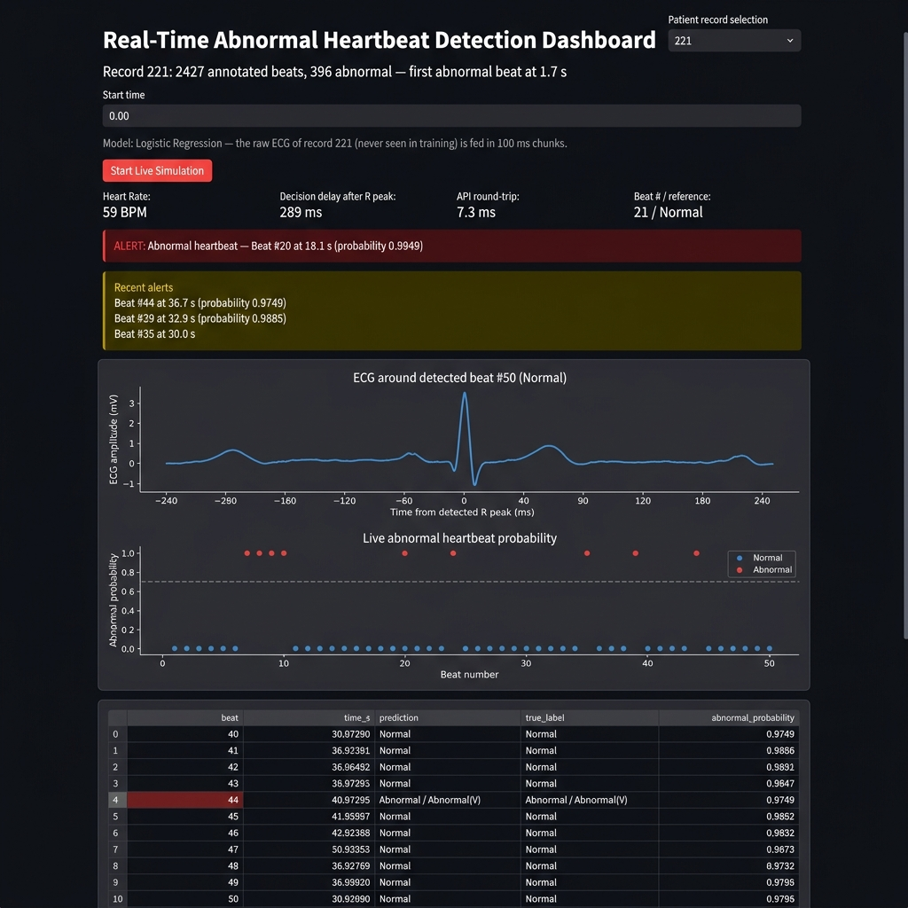
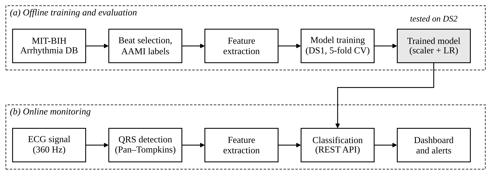
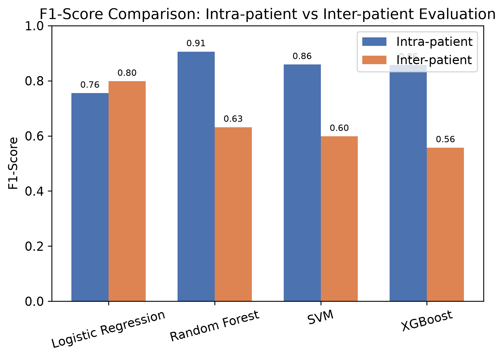
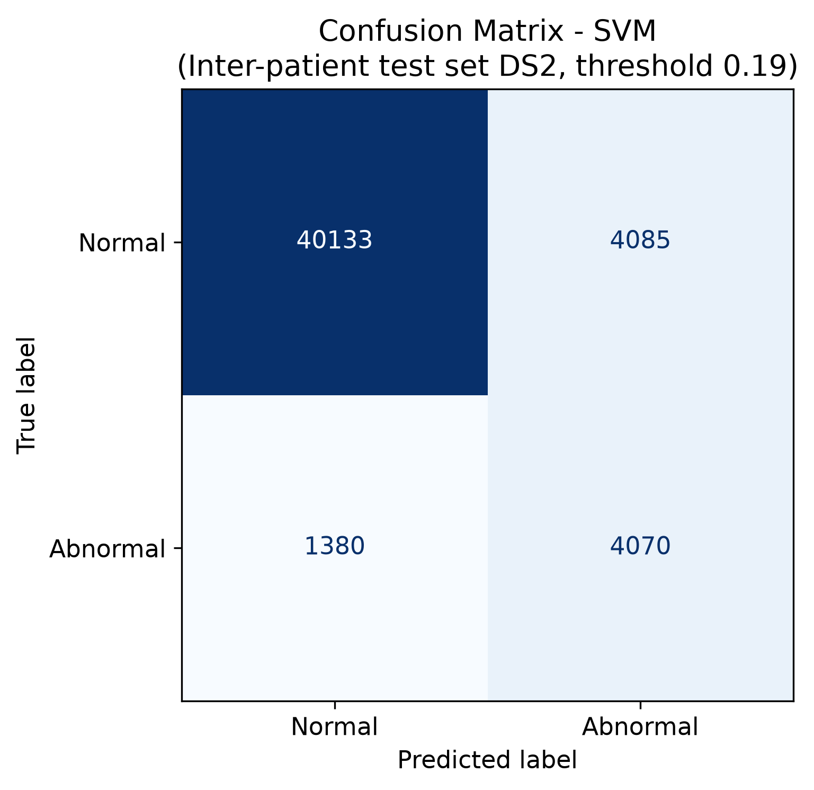
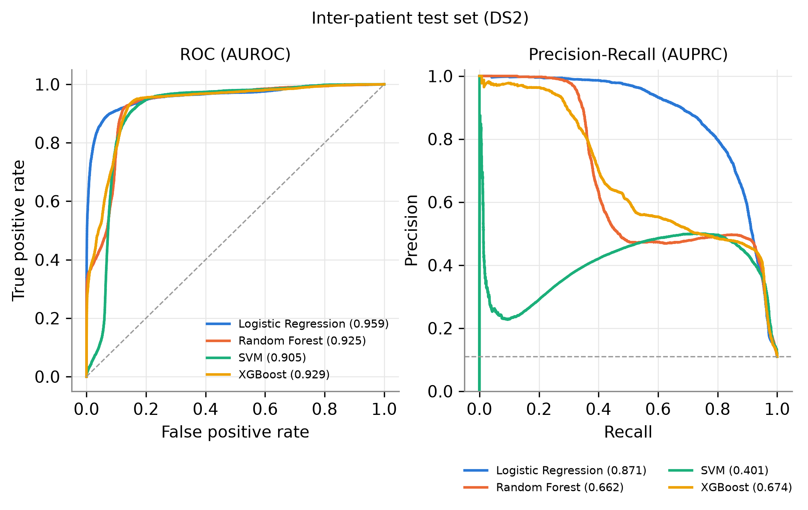
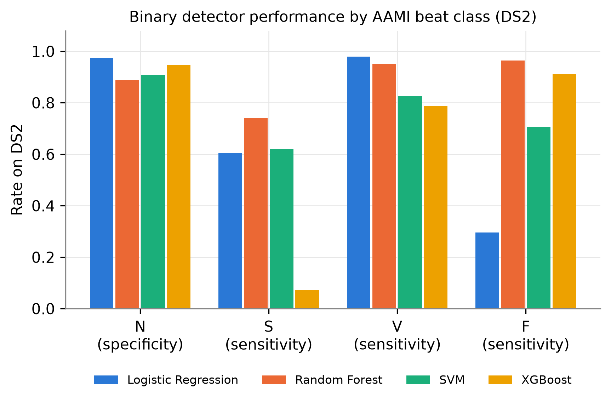
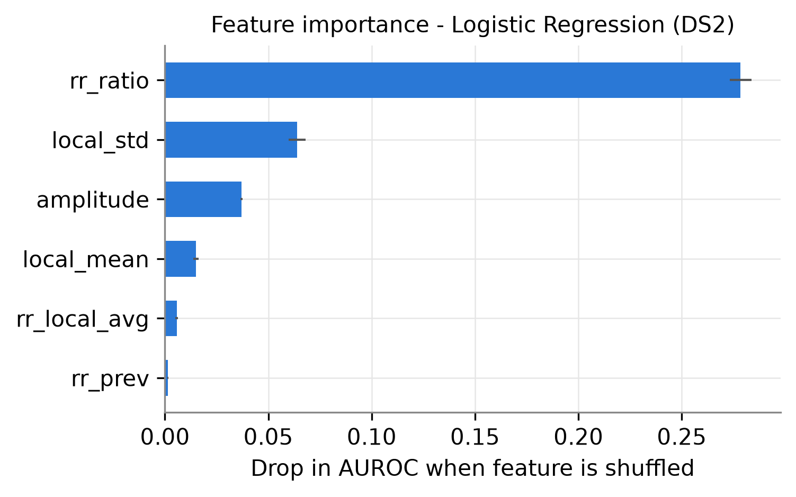
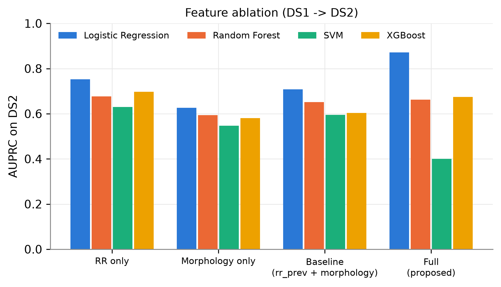
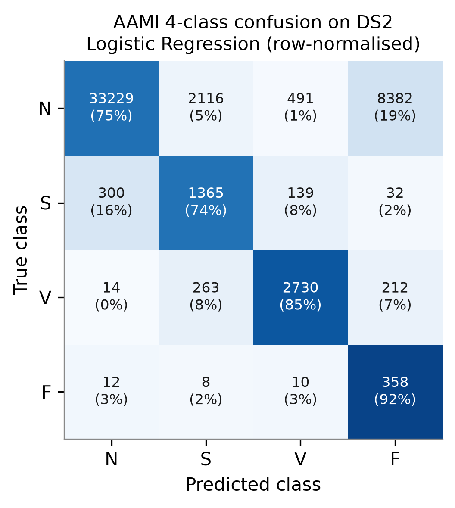

# 🫀 Real-Time ECG Arrhythmia Detection

> **Classical ML pipeline that detects abnormal heartbeats from raw ECG signals — with a causal QRS detector, a FastAPI scoring service, and a live Streamlit dashboard.**


---

## 📋 Table of Contents

- [Overview](#-overview)
- [Dashboard Preview](#-dashboard-preview)
- [System Architecture](#-system-architecture)
- [Dataset](#-dataset)
- [Features](#-features)
- [Models & Results](#-models--results)
- [Project Structure](#-project-structure)
- [Setup & Installation](#-setup--installation)
- [How to Run](#-how-to-run)
- [Live Dashboard](#-live-dashboard)
- [Technical Notes](#-technical-notes)
- [References](#-references)

---

## 🔍 Overview

This project implements a **complete, end-to-end pipeline** for real-time cardiac arrhythmia detection using classical machine learning — no deep learning required. It is designed to be:

- ⚡ **Fast** — sub-millisecond inference, ~250 ms decision latency after an R-peak
- 🔬 **Rigorous** — follows the standard **AAMI EC57 / de Chazal et al. (2004) inter-patient protocol**, the same benchmark used in published MIT-BIH papers
- 🧠 **Interpretable** — Logistic Regression chosen by the one-standard-error rule; all features are clinically meaningful
- 📡 **Real-time capable** — causal Pan-Tompkins QRS detector + FastAPI backend + Streamlit live ECG monitor

**Key results on the held-out DS2 test set (22 patients never seen in training):**

| Metric | Value |
|---|---|
| Accuracy | **95.5%** |
| F1 Score | **79.8%** |
| AUROC | **95.9%** |
| Recall (Sensitivity) | **80.4%** |
| Specificity | **97.4%** |
| Precision | **79.3%** |

---

## 🖥 Dashboard Preview

The live Streamlit dashboard running on a held-out DS2 patient (record 221, 396 abnormal beats):



*Top to bottom: real-time metrics (BPM, decision delay, API latency), abnormal alert banner, recent alerts log, live ECG waveform around the detected beat, beat-by-beat abnormal probability chart (blue = Normal, red = Abnormal), and the prediction data table.*

---

## 🏗 System Architecture

```
Raw ECG Signal (MIT-BIH, 360 Hz)
         │
         ▼
┌─────────────────────┐
│  Pan-Tompkins QRS   │  ← causal, streaming, no look-ahead
│  Detector           │
└────────┬────────────┘
         │  R-peak location + ~250 ms post-peak window
         ▼
┌─────────────────────┐
│  Feature Extraction │  ← 6 causal features (RR intervals + amplitude stats)
└────────┬────────────┘
         │  JSON payload
         ▼
┌─────────────────────┐
│  FastAPI Backend    │  ← /predict endpoint, ~0.2 ms inference
│  (api.py)           │
└────────┬────────────┘
         │  { prediction, abnormal_probability }
         ▼
┌─────────────────────┐
│  Streamlit Dashboard│  ← live ECG waveform + probability chart + alerts
│  (dashboard.py)     │
└─────────────────────┘
```



---

## 📊 Dataset

**MIT-BIH Arrhythmia Database** — the gold-standard benchmark for heartbeat classification.

| Property | Value |
|---|---|
| Source | [PhysioNet](https://physionet.org/content/mitdb/1.0.0/) via `wfdb` |
| Sampling rate | 360 Hz, 11-bit resolution over ±5 mV |
| Records | 48 two-channel, 30-minute recordings |
| Beats | ~110,000 total (after excluding paced records) |
| Patients | 47 subjects (102, 104, 107, 217 excluded — paced beats, AAMI EC57) |

### Inter-patient Split (de Chazal et al., 2004)

Zero patient overlap between train and test:

| Split | Records | Patients | Purpose |
|---|---|---|---|
| **DS1** | 101, 106, 108, 109, 112, 114, 115, 116, 118, 119, 122, 124, 201, 203, 205, 207, 208, 209, 215, 220, 223, 230 | 22 | Training + CV model selection |
| **DS2** | 100, 103, 105, 111, 113, 117, 121, 123, 200, 202, 210, 212, 213, 214, 219, 221, 222, 228, 231, 232, 233, 234 | 22 | Final test (held out) |

> ⚠️ A naive random beat split inflates F1 by ~20–30 pp because beats from the same patient leak into both train and test. The inter-patient protocol is the only fair comparison.

---

## ⚙️ Features

All 6 features are **100% causal** — a beat can be classified ~250 ms after the R-peak with no look-ahead:

| Feature | Description | Clinical relevance |
|---|---|---|
| `rr_prev` | Time since the previous beat (s) | Beat-to-beat interval |
| `rr_local_avg` | Mean of the last 10 RR intervals (s) | Patient's local heart rate baseline |
| `rr_ratio` | `rr_prev / rr_local_avg` | Patient-normalised prematurity index |
| `amplitude` | Signal value at the annotated R-peak (mV) | QRS complex height |
| `local_mean` | Mean of ±90-sample window around the beat | Baseline drift |
| `local_std` | Std of ±90-sample window around the beat | Local signal variability |

`rr_next` is stored in the feature CSV for dashboard playback timing but is **never used for classification**.

---

## 🤖 Models & Results

### Model Selection — 5-fold patient-grouped CV on DS1

The **one-standard-error rule** (Breiman et al., 1984; Hastie et al., 2009) selects the *simplest* model within one SE of the best CV F1:

| Model | CV F1 (mean ± std) | CV AUROC | Selected |
|---|---|---|---|
| Logistic Regression | 0.529 ± 0.202 | 0.875 ± 0.092 | ✅ **Yes** |
| SVM (RBF, Platt-scaled) | within 1 SE | — | eligible |
| Random Forest | within 1 SE | — | eligible |
| XGBoost | within 1 SE | — | eligible |

Decision threshold tuned on out-of-fold predictions only (DS2 never touched): **0.716**

### DS2 Test Results







### Per-class Detection (AAMI N/S/V/F)



| AAMI Class | Beats | Metric |
|---|---|---|
| **N** (Normal + BBB) | majority | Specificity |
| **S** (Supraventricular ectopic) | rare | Sensitivity |
| **V** (Ventricular ectopic) | moderate | Sensitivity |
| **F** (Fusion) | rare | Sensitivity |

### Feature Importance & Ablation







### Intra- vs. Inter-patient Performance Gap

| Evaluation | F1 |
|---|---|
| Intra-patient (random split, inflated) | ~0.97+ |
| **Inter-patient DS1→DS2 (fair)** | **0.798** |

This ~17 pp gap illustrates why inter-patient evaluation is essential for any clinical comparison.

---

## 📁 Project Structure

```
ecg-arrhythmia-project/
├── data/
│   ├── mitbih_data/                       # raw ECG records (auto-created by load_data.py)
│   ├── ecg_features.csv                   # extracted features (created by feature_extraction.py)
│   └── ecg_features_detected.csv          # features from QRS-detected beats
├── models/
│   ├── best_model.pkl                     # best model — full sklearn Pipeline (scaler inside)
│   ├── model_meta.json                    # name, features, threshold, DS1/DS2 records, metrics
│   ├── cv_results_ds1.csv                 # per-fold CV metrics
│   ├── cv_summary_ds1.csv                 # mean ± std CV metrics per model
│   ├── model_comparison_both_splits.csv   # intra vs inter-patient comparison
│   ├── per_class_detection_ds2.csv        # N specificity, S/V/F sensitivity on DS2
│   ├── ds2_bootstrap_ci.csv               # 95% CIs (patient-level bootstrap)
│   ├── aami_multiclass_ds2.csv            # 4-class N/S/V/F: Se, +P, F1 per class
│   ├── ablation_ds2.csv                   # feature-set ablation study
│   ├── permutation_importance.csv
│   ├── latency_benchmark.csv
│   ├── ds2_predictions.csv                # per-beat DS2 probabilities for every model
│   ├── end_to_end_results.csv             # end-to-end pipeline evaluation
│   ├── qrs_detection_results.csv          # QRS detector accuracy
│   ├── train_test_accuracy.csv
│   ├── train_vs_test_distribution_check.csv
│   └── figures/                           # all generated publication figures
│       ├── fig0_system_architecture.png
│       ├── fig1_f1_comparison.png
│       ├── fig2_confusion_matrix.png
│       ├── fig3_roc_pr_ds2.png
│       ├── fig4_per_class_detection.png
│       ├── fig5_ablation.png
│       ├── fig6_aami_confusion.png
│       ├── fig7_feature_importance.png
│       └── ecg_realtime_architecture.png
├── src/
│   ├── config.py                          # shared paths, features, label rules, split settings
│   ├── load_data.py                       # Part 1: download ECG records via wfdb
│   ├── feature_extraction.py              # Part 2: extract 6 ML features from beats
│   ├── train_models.py                    # Part 3: CV model selection + DS1→DS2 test
│   ├── paper_experiments.py               # CIs, AAMI 4-class, ablation, importance, ROC/PR
│   ├── generate_figures.py                # fig1 F1 comparison, fig2 confusion matrix
│   ├── draw_architecture.py               # system architecture diagram
│   ├── qrs_detector.py                    # causal streaming Pan-Tompkins QRS detector
│   ├── realtime_pipeline.py               # raw samples → detected beats → 6 features
│   ├── end_to_end_eval.py                 # detector accuracy + classification on detected beats
│   ├── latency_benchmark.py               # per-beat inference latency benchmarking
│   ├── check_train_test_diff.py           # distribution shift check
│   ├── train_test_accuracy.py             # train vs test accuracy comparison
│   ├── api.py                             # Part 4: FastAPI real-time scoring service
│   └── dashboard.py                       # Part 5: Streamlit live monitoring dashboard
├── requirements.txt
└── README.md
```

---

## 🛠 Setup & Installation

### Prerequisites

- Python **3.10+** (tested with Python 3.14.7)
- pip

### Install dependencies

```bash
pip install -r requirements.txt
```

---

## 🚀 How to Run

All scripts should be run from the `src/` directory:

```bash
cd src
```

### Step 1 — Download data

```bash
python load_data.py
```

Downloads MIT-BIH records from PhysioNet via `wfdb`. Records already present are skipped.

```bash
python load_data.py --test   # quick test: fetches only 3 records
```

### Step 2 — Extract features

```bash
python feature_extraction.py
```

Creates `data/ecg_features.csv` — one row per heartbeat across every complete record.
Paced records 102, 104, 107, 217 are excluded per AAMI EC57.
Non-beat annotations (`+ ~ " | x ! [ ]`) are ignored.

### Step 3 — Train and evaluate models

```bash
python train_models.py
```

Runs three evaluations in sequence:

1. **Model selection** — 5-fold patient-grouped CV on DS1, threshold tuned on out-of-fold predictions only. DS2 is never touched.
2. **Inter-patient test** — every model refit on DS1, tested once on DS2 (de Chazal et al., 2004).
3. **Intra-patient contrast** — random beat split, reported for comparison only.

Saves `models/best_model.pkl` + `models/model_meta.json`. *(Takes a few minutes — SVM is the slow part.)*

### Step 3b — Paper experiments, CI and figures

```bash
python paper_experiments.py     # CIs, AAMI 4-class table, ablation, importance, ROC/PR curves
python generate_figures.py      # fig1 F1 comparison, fig2 confusion matrix
python latency_benchmark.py     # per-beat latency statistics
python check_train_test_diff.py # distribution shift check
```

### Step 3c — End-to-end evaluation with the QRS detector

```bash
python end_to_end_eval.py
```

Runs the full pipeline from raw ECG without reference annotations:
detector sensitivity/PPV (150 ms tolerance, AAMI EC57) + classifier on detected beats.

### Step 4 — Start the real-time API *(keep this terminal running)*

```bash
uvicorn api:app --reload --port 8000
```

Example request:

```bash
curl -X POST http://127.0.0.1:8000/predict \
  -H "Content-Type: application/json" \
  -d '{"rr_prev": 0.78, "rr_local_avg": 0.80, "rr_ratio": 0.975, "amplitude": 1.2, "local_mean": 0.05, "local_std": 0.18}'
```

Response:

```json
{ "prediction": "Normal", "abnormal_probability": 0.043 }
```

### Step 5 — Start the live dashboard *(second terminal)*

```bash
streamlit run dashboard.py
```

---

## 📺 Live Dashboard

The Streamlit dashboard streams raw ECG from a held-out DS2 patient in **100 ms chunks**,
runs the causal QRS detector, sends features to the FastAPI backend, and renders real-time predictions.

**Features:**
- 📈 Live ECG waveform around each beat (red = abnormal, blue = normal)
- 📊 Abnormal probability time series with decision threshold line
- 💓 Live heart rate (BPM) from detected RR intervals
- ⏱️ Decision delay after R-peak and API round-trip latency
- 🚨 Real-time alert log for abnormal beats
- 🔍 True label vs. predicted label (reference used for display only)

**To use:** start the API (Step 4), then the dashboard (Step 5), open the Streamlit URL,
select a DS2 patient, and click **"Start Live Simulation"**.

> Replay runs at **4× real-time** by default (`TIME_COMPRESSION = 4`).

---

## 📐 Technical Notes

### Label Mapping

```python
# Normal (AAMI class N)
NORMAL_LABELS = {'N', 'L', 'R', 'e', 'j'}

# AAMI classes (for per-class reporting)
# S: Supraventricular ectopic  (A, a, J, S)
# V: Ventricular ectopic       (V, E)
# F: Fusion                    (F)
# Q: Paced / unclassifiable    (/, f, Q, ?)
```

### QRS Detector

`qrs_detector.py` implements a **causal streaming Pan-Tompkins algorithm**:
bandpass → derivative → squaring → moving window integration → adaptive thresholds.
No future samples are ever used. Evaluated with ±150 ms AAMI EC57 tolerance.

### Platt Scaling for SVM

Scikit-learn ≥ 1.9 deprecates `SVC(probability=True)`. This project uses
`CalibratedClassifierCV(method="sigmoid")` (Platt scaling) as the recommended replacement.

### Why Classical ML?

- **Interpretable**: Logistic Regression coefficients have direct clinical meaning
- **Fast**: ~0.02 ms inference per beat — well within real-time constraints
- **Honest**: Inter-patient gap is fully quantified; no hidden patient-level data leakage

---

## 📚 References

- **de Chazal et al.** (2004). Automatic classification of heartbeats using ECG morphology and heartbeat interval features. *IEEE Trans. Biomed. Eng.*, 51(7), 1196–1206.
- **Pan & Tompkins** (1985). A real-time QRS detection algorithm. *IEEE Trans. Biomed. Eng.*, 32(3), 230–236.
- **Moody & Mark** (2001). The impact of the MIT-BIH Arrhythmia Database. *IEEE Eng. Med. Biol. Mag.*, 20(3), 45–50.
- **ANSI/AAMI EC57** (1998/2012). Testing and reporting performance results of cardiac rhythm and ST segment measurement algorithms.
- **Breiman et al.** (1984). *Classification and Regression Trees*. Wadsworth.
- **Hastie, Tibshirani & Friedman** (2009). *The Elements of Statistical Learning* (2nd ed.). Springer.

---

## 📄 License

This project is licensed under the **MIT License**.

---

<p align="center">Made with ❤️ for reproducible clinical ML research</p>
